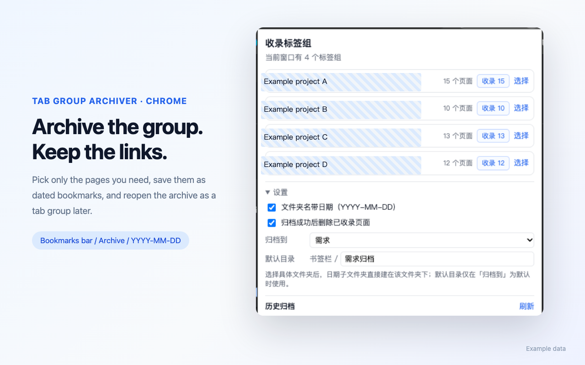
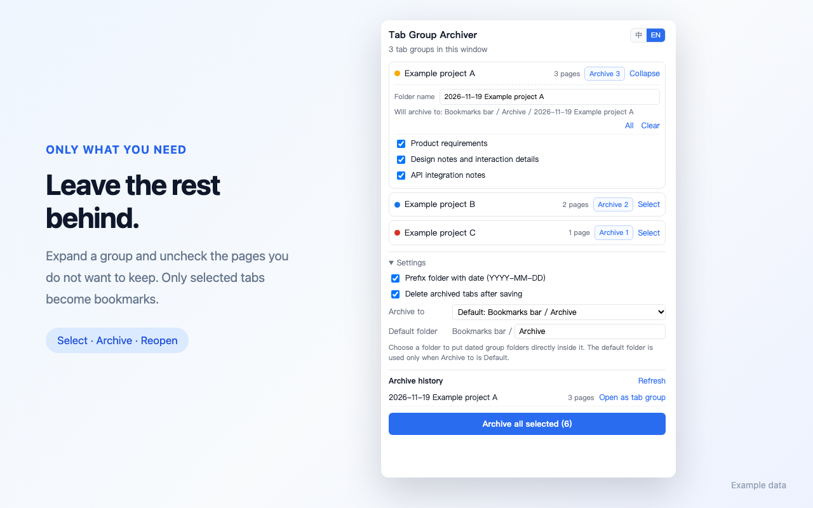

# Tab Group Archiver

**A Chrome extension that archives selected tabs from tab groups into dated bookmark folders — and can reopen an archive as a tab group.**

[](#install)
[](LICENSE)
[](https://github.com/FinA1ee/chrome-tabgroup-bookmark/releases)

[中文说明](README.zh-CN.md) · [Latest release](https://github.com/FinA1ee/chrome-tabgroup-bookmark/releases/tag/v1.1.7) · [Privacy](PRIVACY.md) · [MIT License](LICENSE)



Chrome tab groups are great for active work but easy to lose after a project ends. Tab Group Archiver turns a group into a bookmark folder before you close it:

```text
Bookmarks bar / Archive / 2026-11-19 Project name
```

The extension is local-only: no account, no backend, no analytics, no network requests.

## Features

- **Pick only the tabs you need.** Expand a group and uncheck pages you do not want to keep.
- **Dated archive folders.** The default layout is `Bookmarks bar / Archive / YYYY-MM-DD Group name`.
- **Choose a destination.** Use the default archive folder or any existing bookmark folder.
- **Safe to repeat.** Existing folders are reused and duplicate URLs are skipped.
- **Delete after archiving.** On by default: only successfully archived, selected tabs are closed. Unselected tabs and failed writes are kept.
- **Reopen an archive as a tab group.** The history list can recreate the pages and group them under the original folder name.
- **English and Chinese UI.** Switch between 中 and EN in the popup header; the choice is saved locally.
- **Popup-safe writes.** Bookmark writes run in the MV3 service worker, so closing the popup does not stop an archive already in progress.



## Install

The popup UI defaults to English and supports Simplified Chinese; use the `中 / EN` switch in the header. The screenshots use English.

1. Download the latest ZIP from [Releases](https://github.com/FinA1ee/chrome-tabgroup-bookmark/releases).
2. Unzip it anywhere.
3. Open `chrome://extensions`.
4. Enable **Developer mode**.
5. Click **Load unpacked** and select the unzipped folder.
6. Pin **Tab Group Archiver** to the toolbar.

No build step and no package installation are required. The repository itself can also be loaded as an unpacked extension.

## Usage

1. Click the extension icon. It lists tab groups in the current window.
2. Click **选择** (Select) to expand a group.
3. Uncheck pages you do not want to archive.
4. Click **收录 N** (Archive N) for one group, or **收录全部选中** (Archive all selected) for all groups.
5. Check the bookmark folder and the result summary.
6. To restore an archive, open **历史归档** (Archive history) and click **以标签组打开** (Open as tab group).

### What gets skipped

- `chrome://`, `chrome-extension://`, `devtools://` and other non-web pages
- URLs that already exist in the target folder
- A tab whose URL is not available yet

### Behavior notes

- `file://` pages require **Allow access to file URLs** in the extension details.
- Archive folders and dated group folders are direct children; the extension does not create multi-level paths.
- Reopened groups use Chrome's default group color; the folder name is restored as the group title.
- URL deduplication is exact: query strings and hashes are not normalized.
- A failed bookmark write prevents automatic page deletion for that group.

## Permissions

| Permission | Why it is needed |
|---|---|
| `tabs` | Read tab titles/URLs and create tabs when reopening an archive |
| `tabGroups` | Read group names and create/update tab groups |
| `bookmarks` | Create and read archive folders and bookmarks |
| `storage` | Save archive destination and behavior settings |

There are **no host permissions**, no content scripts, and no remote code.

## Architecture

```text
Popup (popup.html / popup.css / popup.js)
  ├─ lists groups and tabs
  ├─ manages selection and settings
  └─ sends runtime messages
          │
          ▼
Service worker (background.js)
  ├─ validates and queues archive requests
  ├─ creates/reuses bookmark folders
  ├─ deduplicates URLs
  ├─ deletes only successfully archived tabs
  └─ reopens bookmark folders as tab groups
          │
          ▼
Chrome APIs: tabs · tabGroups · bookmarks · storage
```

Why a service worker? A popup is destroyed when it loses focus. Moving bookmark writes into the extension service worker makes an archive that has already started much less likely to be interrupted. The worker can still be terminated when idle, so the implementation also uses a serialized queue, URL deduplication, and a no-delete-on-failure rule.

The shared pure functions live in [`lib.js`](lib.js); the design rationale is in [`design.md`](design.md).

## Data and privacy

Only one settings object is stored locally:

```js
{
  rootFolder: "Archive",
  destinationFolderId: null,
  datePrefix: true,
  closeAfterSave: true
}
```

- Settings use `chrome.storage.local` and are not synced across devices.
- Bookmarks are Chrome's native bookmark data and follow the user's Chrome Sync settings.
- Selection state, the queue, and the current result stay in memory only.
- No localStorage, IndexedDB, cookies, or network requests are used.

See [PRIVACY.md](PRIVACY.md) for details.

## Development

```sh
npm test
node --check popup.js
node --check lib.js
node --check background.js
```

Test coverage:

- `test.mjs`: date formatting, folder-name sanitization, URL filtering, summaries
- `test-background.mjs`: mocked Chrome APIs for selection, destination folders, deduplication, failure handling, auto-delete, and reopening archives

GitHub Actions runs both tests and syntax checks on every push.

## Release

- [v1.1.7](https://github.com/FinA1ee/chrome-tabgroup-bookmark/releases/tag/v1.1.7)
- Store copy and screenshot checklist: [STORE.md](STORE.md)
- Chrome Web Store submission is pending a developer account review.

## License

[MIT](LICENSE)
